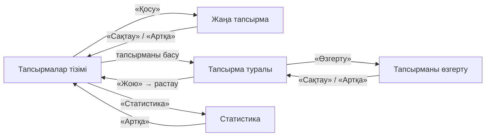
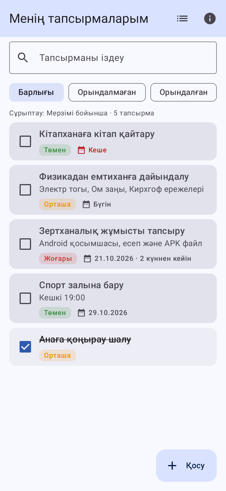
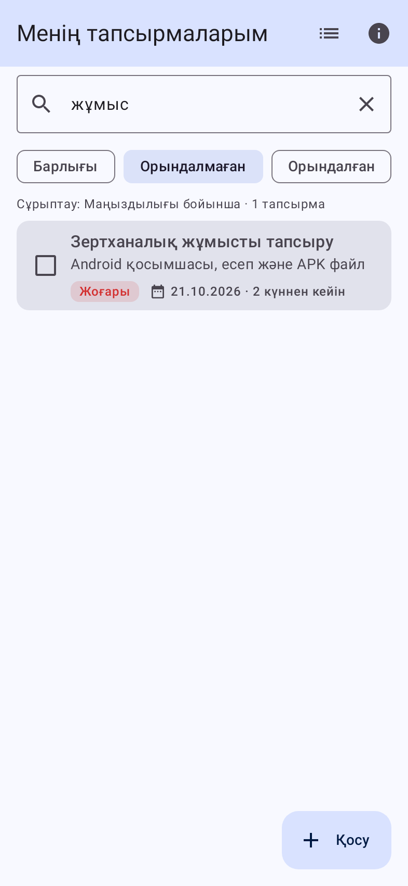
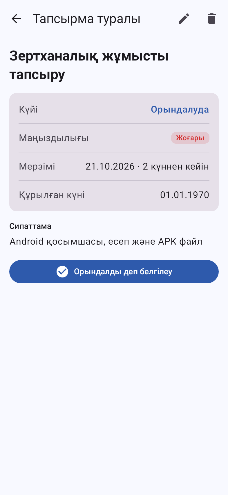
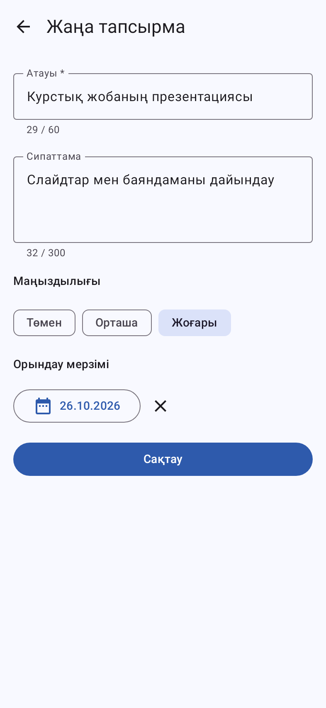
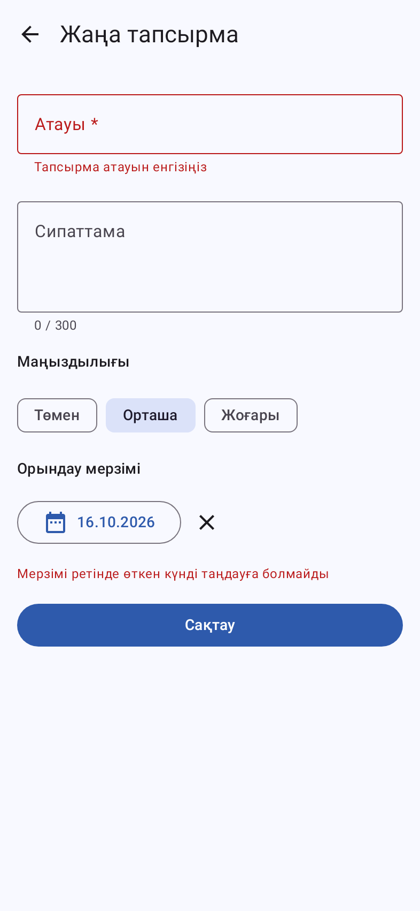
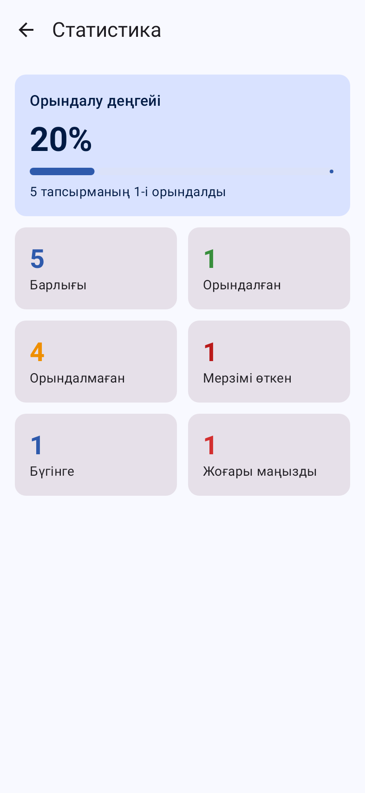

# Практикалық жұмыс бойынша есеп

**Пән:** Android платформасында мобильдік бағдарламалау
**Жұмыс:** Android мобильді қосымшасын жобалау және әзірлеу
**Таңдалған тақырып:** №3 — Күнделікті тапсырмалар тізімі

---

## 1. Жұмыстың тақырыбы мен мақсаты

**Тақырыбы:** «Тапсырмалар» — күнделікті тапсырмаларды есепке алатын Android қосымшасы.

**Мақсаты:** Android қосымшасының интерфейсін жобалау, экрандар арасындағы навигацияны ұйымдастыру және жергілікті деректер қорымен (Room, DataStore) жұмыс істеу дағдыларын бекіту.

## 2. Қосымшаның қысқаша сипаттамасы

Қосымша пайдаланушыға күнделікті тапсырмаларын жазып, бақылап отыруға көмектеседі. Негізгі мүмкіндіктері:

| Функция (тапсырма бойынша) | Іске асырылуы |
|---|---|
| Тапсырманы қосу | «Қосу» батырмасы → «Жаңа тапсырма» экраны |
| Тапсырманы өзгерту | Толық ақпарат экранындағы ✏️ белгішесі |
| Тапсырманы жою | 🗑 белгішесі + растау диалогы |
| Орындалғанын белгілеу | Тізімдегі құсбелгі немесе «Орындалды деп белгілеу» батырмасы |
| Мерзімі бойынша сұрыптау | Сұрыптау мәзірі: «Мерзімі бойынша» |
| Маңыздылығы бойынша сұрыптау | Сұрыптау мәзірі: «Маңыздылығы бойынша» |
| Қосымша | Іздеу, күйі бойынша сүзгі, «Атауы бойынша», «Жаңалары алдымен» сұрыптауы, статистика экраны |

Әр тапсырмада: атауы, сипаттамасы, маңыздылығы (Төмен / Орташа / Жоғары), орындау мерзімі, күйі және құрылған күні сақталады. Мерзімі өтіп кеткен тапсырмалар қызыл түспен белгіленеді.

**Технологиялар:** Kotlin, Jetpack Compose (Material 3), Navigation Compose, Room, DataStore Preferences, ViewModel + StateFlow (MVVM архитектурасы). `minSdk 26`, `targetSdk 35`.

## 3. Экрандардың құрылымы және олардың байланысы

Қосымшада 4 экран бар:

1. **Тапсырмалар тізімі** (`TaskListScreen`) — басты экран: іздеу жолы, «Барлығы / Орындалмаған / Орындалған» сүзгісі, сұрыптау мәзірі, тапсырмалар тізімі, «Қосу» батырмасы.
2. **Тапсырма туралы** (`TaskDetailScreen`) — тапсырманың толық ақпараты, күйін ауыстыру, өзгерту және жою.
3. **Жаңа тапсырма / Тапсырманы өзгерту** (`TaskEditScreen`) — енгізу формасы, мәндерді тексеру, күнтізбеден мерзім таңдау.
4. **Статистика** (`StatsScreen`) — орындалу пайызы және санаттар бойынша сандар.



Навигация `AppNavHost.kt` файлында `NavHost` арқылы сипатталған. Маршруттар:

| Маршрут | Экран | Аргумент |
|---|---|---|
| `tasks` | Тізім | — |
| `tasks/{taskId}` | Толық ақпарат | `taskId: Long` (міндетті) |
| `edit?taskId={taskId}` | Қосу / өзгерту | `taskId: Long` (әдепкі `-1` — жаңа тапсырма) |
| `stats` | Статистика | — |

## 4. Жобаның құрылымы

```
app/src/main/java/kz/labka/tapsyrma/
├── MainActivity.kt            — жалғыз Activity, Compose мазмұнын орнатады
├── TasksApp.kt                — Application + тәуелділіктер контейнері
├── data/
│   ├── Task.kt                — Room entity және Priority enum
│   ├── Converters.kt          — LocalDate және Priority түрлендіргіштері
│   ├── TaskDao.kt             — SQL сұраулары (CRUD)
│   ├── AppDatabase.kt         — Room деректер қоры
│   ├── TaskRepository.kt      — деректерге қол жеткізу қабаты
│   └── SettingsStore.kt       — DataStore: сұрыптау мен сүзгіні есте сақтау
├── domain/
│   ├── TaskQuery.kt           — іздеу, сүзу, сұрыптау
│   ├── TaskValidator.kt       — енгізілген мәндерді тексеру
│   └── TaskStats.kt           — статистиканы есептеу
└── ui/
    ├── navigation/AppNavHost.kt
    ├── list/    detail/    edit/    stats/   — әр экранның Screen + ViewModel
    ├── common/Common.kt       — ортақ компоненттер (маңыздылық белгісі, күн форматы)
    └── theme/Theme.kt         — Material 3 тақырыбы (жарық/қараңғы)
```

## 5. Негізгі код бөліктерінің түсіндірмесі

### 5.1 Деректер моделі (Room Entity)

```kotlin
@Entity(tableName = "tasks")
data class Task(
    @PrimaryKey(autoGenerate = true) val id: Long = 0,
    val title: String,
    val description: String = "",
    val dueDate: LocalDate? = null,
    val priority: Priority = Priority.MEDIUM,
    val isDone: Boolean = false,
    val createdAt: Long = System.currentTimeMillis(),
)
```

`@Entity` класты `tasks` кестесіне айналдырады. Room `LocalDate` пен `enum` типтерін тікелей сақтай алмайтындықтан, `Converters` класы оларды `Long` (epochDay) және `String` түріне түрлендіреді.

### 5.2 DAO — деректер қорына сұраулар

```kotlin
@Query("SELECT * FROM tasks")
fun observeAll(): Flow<List<Task>>

@Insert(onConflict = OnConflictStrategy.REPLACE)
suspend fun insert(task: Task): Long

@Query("UPDATE tasks SET isDone = :done WHERE id = :id")
suspend fun setDone(id: Long, done: Boolean)
```

`Flow` қайтаратын сұраулар кесте өзгерген сайын жаңа мәнді өздігінен жібереді, сондықтан тізім қосу/жою/өзгертуден кейін автоматты түрде жаңарады. `suspend` функциялар деректер қорымен негізгі ағыннан тыс (корутинада) жұмыс істейді.

### 5.3 ViewModel және экран күйі (MVVM)

```kotlin
val uiState: StateFlow<TaskListUiState> = combine(
    repository.observeTasks(),   // Room-дағы тапсырмалар
    snapshotFlow { query },      // іздеу жолы
    settings.statusFilter,       // DataStore-дағы сүзгі
    settings.sortOrder,          // DataStore-дағы сұрыптау
) { tasks, text, filter, sort ->
    TaskListUiState(tasks = TaskQuery.apply(tasks, text, filter, sort), ...)
}.stateIn(viewModelScope, SharingStarted.WhileSubscribed(5_000), TaskListUiState())
```

ViewModel төрт дереккөзді біріктіріп, экранға дайын күй береді. Экран (`TaskListScreen`) тек осы күйді көрсетеді және пайдаланушы әрекеттерін ViewModel-ге жібереді. ViewModel экран бұрылғанда (конфигурация өзгергенде) жойылмайды, сондықтан деректер жоғалмайды.

### 5.4 Іздеу, сүзу және сұрыптау

```kotlin
tasks
    .filter { text.isEmpty() || it.title.contains(text, true) || it.description.contains(text, true) }
    .filter { when (filter) { ALL -> true; ACTIVE -> !it.isDone; DONE -> it.isDone } }
    .sortedWith(compareBy<Task> { it.isDone }.then(comparator(sort)))
```

Іздеу атауы мен сипаттамасы бойынша, әріп регистріне қарамай жүргізіледі. Орындалмаған тапсырмалар әрқашан жоғарыда тұрады, ал ішінде таңдалған тәртіппен (мерзімі, маңыздылығы, атауы, құрылған уақыты) сұрыпталады. Таңдалған сұрыптау мен сүзгі **DataStore**-да сақталады, сондықтан қосымша қайта ашылғанда да есте қалады.

### 5.5 Енгізілген мәндерді тексеру

```kotlin
val titleError = when {
    cleanTitle.isEmpty() -> "Тапсырма атауын енгізіңіз"
    cleanTitle.length < TITLE_MIN -> "Атауы кемінде 3 таңбадан тұруы керек"
    cleanTitle.length > TITLE_MAX -> "Атауы 60 таңбадан аспауы керек"
    else -> null
}
```

Тексерілетін жағдайлар: бос атау, тым қысқа/ұзын атау, 300 таңбадан ұзын сипаттама, мерзімі ретінде өткен күнді таңдау. Қате болса, өріс қызыл түспен белгіленіп, астында хабарлама шығады, ал экранның төменгі жағында Snackbar көрсетіледі. Пайдаланушы өрісті түзете бастағанда қате жасырылады. Деректер қорына жазу кезіндегі күтпеген қателер `try/catch` арқылы ұсталып, хабарлама ретінде көрсетіледі.

### 5.6 Навигация

```kotlin
composable(
    route = "tasks/{taskId}",
    arguments = listOf(navArgument("taskId") { type = NavType.LongType }),
) {
    TaskDetailScreen(onBack = { navController.navigateUp() }, onEdit = { id -> navController.navigate("edit?taskId=$id") })
}
```

Экрандар бір-біріне тек тапсырманың `id`-ін береді. Аргумент ViewModel-ге `SavedStateHandle` арқылы келеді, ал ViewModel тапсырманы Room-нан өзі жүктейді.

## 6. Қосымша жұмысының скриншоттары

| Тапсырмалар тізімі | Іздеу және сүзгі | Тапсырма туралы |
|:---:|:---:|:---:|
|  |  |  |

| Жаңа тапсырма | Қате енгізу | Статистика |
|:---:|:---:|:---:|
|  |  |  |

> Скриншоттарды GitHub Actions `ScreenshotTest` тесті (Robolectric) арқылы автоматты түрде жасайды.

## 7. Тестілеу нәтижесі

### 7.1 Автоматты тесттер (`./gradlew testDebugUnitTest`)

| Тест класы | Не тексеріледі | Нәтиже |
|---|---|---|
| `TaskValidatorTest` (6 тест) | Бос атау, қысқа/ұзын атау, ұзын сипаттама, өткен күн, бұрынғы мерзімді өзгертпей сақтау | ✅ өтті |
| `TaskQueryTest` (6 тест) | Регистрге тәуелсіз іздеу, күйі бойынша сүзгі, 3 түрлі сұрыптау, статистика | ✅ өтті |
| `TaskDaoTest` (1 тест) | Room: қосу → оқу → өзгерту → орындалды деп белгілеу → жою | ✅ өтті |
| `ScreenshotTest` (6 тест) | Барлық экрандардың қатесіз көрсетілуі | ✅ өтті |

### 7.2 Қолмен тексерілетін сценарийлер

| № | Сценарий | Күтілетін нәтиже |
|---|---|---|
| 1 | Атауы бос тапсырманы сақтау | «Тапсырма атауын енгізіңіз» қатесі, тапсырма сақталмайды |
| 2 | Мерзімі ретінде кешегі күнді таңдау | «Мерзімі ретінде өткен күнді таңдауға болмайды» қатесі |
| 3 | Дұрыс тапсырма қосу | Тізімге қосылады, мерзімі бойынша өз орнына тұрады |
| 4 | Құсбелгіні басу | Тапсырма сызылып, тізімнің соңына түседі |
| 5 | Тапсырманы өзгерту | Өзгерістер тізімде және толық ақпаратта көрінеді |
| 6 | Жою → «Болдырмау» / «Жою» | Болдырмағанда сақталады, растағанда жойылып тізімге оралады |
| 7 | Іздеу жолына сөз жазу | Атауында немесе сипаттамасында сол сөзі бар тапсырмалар ғана қалады |
| 8 | Сұрыптау мен сүзгіні ауыстырып, қосымшаны жабу/ашу | Тапсырмалар да, таңдалған сұрыптау мен сүзгі де сақталып тұрады |
| 9 | Экранды бұру | Енгізілген мәтін мен тізім күйі жоғалмайды |

## 8. Бақылау сұрақтарына жауаптар

1. **Activity немесе Composable экран қандай қызмет атқарады?** Activity — қосымшаның Android жүйесіне кіру нүктесі, ол терезені және өмірлік циклді басқарады. Бұл жобада бір ғана `MainActivity` бар, ол `setContent { }` арқылы Compose интерфейсін орнатады. Composable экран — интерфейстің бір бөлігін сипаттайтын функция: ол күйді (state) қабылдап, оны көрсетеді, ал күй өзгергенде қайта сызылады (recomposition).
2. **Экрандар арасындағы навигация қалай ұйымдастырылады?** Navigation Compose кітапханасы арқылы: `NavHost` ішінде әр экранға маршрут (`route`) беріледі, `navController.navigate("tasks/5")` келесі экранға өтеді, `navigateUp()` артқа қайтарады. Экрандар арасында тек қарапайым аргументтер (мұнда — `taskId`) беріледі.
3. **Room мен DataStore қандай жағдайларда қолданылады?** Room — құрылымдық, көп жазбалы деректерге (тапсырмалар кестесі), SQL сұраулары, сүзу, байланыстар қажет болғанда. DataStore — аз көлемді «кілт–мән» баптауларына (мұнда — таңдалған сұрыптау мен сүзгі).
4. **Пайдаланушы енгізген деректерді тексеру не үшін қажет?** Деректер қорына мағынасыз немесе қате мәндер (бос атау, өткен мерзім, тым ұзын мәтін) түспеуі үшін, қосымшаның бұзылмауы үшін және пайдаланушыға нақты не дұрыс емес екенін түсіндіру үшін.
5. **MVVM архитектурасында ViewModel қандай міндет атқарады?** ViewModel экран күйін сақтайды және дайындайды, пайдаланушы әрекеттерін өңдейді (сақтау, жою, сүзу), репозиторий арқылы деректермен жұмыс істейді. Ол экран бұрылғанда жойылмайды, ал View (Composable) тек күйді көрсетумен айналысады.

## 9. Қорытынды

Практикалық жұмыс барысында Kotlin тілінде Jetpack Compose негізінде «Тапсырмалар» Android қосымшасы әзірленді. Қосымша 4 экраннан тұрады, экрандар арасындағы навигация Navigation Compose арқылы іске асырылды. Деректер Room деректер қорында, ал пайдаланушы баптаулары DataStore-да сақталады, сондықтан қосымша жабылып қайта ашылғанда ақпарат жоғалмайды. Тапсырмаларды қосу, өзгерту, жою, орындалғанын белгілеу, іздеу, сүзу және мерзімі/маңыздылығы бойынша сұрыптау функциялары жасалды. Бос және қате мәндер тексеріліп, пайдаланушыға қазақ тілінде түсінікті хабарламалар шығарылады. Жобада MVVM архитектурасы қолданылды, негізгі логика автоматты тесттермен тексерілді.

## 10. Тапсыру материалдары

- Git репозиторийі: осы репозиторий
- Орнатуға дайын APK: [`release/Tapsyrmalar.apk`](release/Tapsyrmalar.apk)
- Есеп: осы файл (`ESEP.md`)
